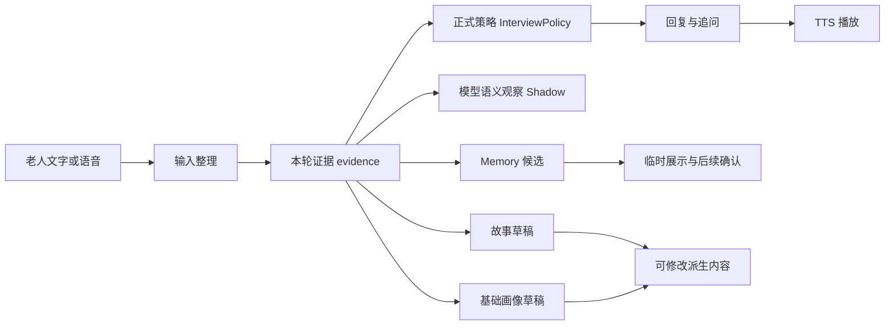

# 结果和状态说明（给产品、内容、测试）

## 1. 一次输入经过什么流程

算法侧把每轮用户输入保留为有来源的本轮证据。正式策略负责决定现在是否承接、追问、等待、换题、暂停或结束；模型语义观察只帮助我们了解“用户可能想表达什么”，不能直接发出保存、删除、分享或切换模式的命令。

语音输入先经过 ASR。短句可以去掉明显的“嗯、啊”等填充词并适度规整标点，但不能改变原意，也不能把语速、停顿等信息混入认知干预判断。正式访谈和日常聊天使用同一条输入链路，区别由会话模式和策略决定。

## 2. 页面应该展示什么

| 区域 | 给用户看的内容 | 不应该展示 |
|---|---|---|
| 当前回复 | AI 的文字、播放状态、是否等待、是否被打断 | provider 原始错误、密钥、内部 ID |
| 本轮 Memory | 提取了几条、哪些可用、哪些因来源不足被拒绝 | “已经永久保存” |
| Memory 列表 | 临时/候选内容、来源、用途、敏感性和确认状态 | 把候选伪装成正式长期记忆 |
| 故事草稿 | 文章标题、正文、来源轮次、草稿状态 | 未经用户同意的定稿或公开发布 |
| 基础画像 | 兴趣、偏好、经历等已得到依据的摘要 | 根据一次表现推断健康、人格或家庭关系 |
| 测试诊断 | 算法工程师和测试人员的结构化日志 | 老人端的复杂诊断字段 |

算法工作台可以同时展示 Memory、故事、画像和 Shadow；老人端只需要清楚的回复、等待、失败和确认状态。

## 3. Memory 的三个层次

当前候选包只负责“提取和展示”，不打开生产 `CanonicalMemory` 写入。产品和全栈应按下面的概念展示：

1. **本轮候选**：刚从当前输入中提取，带有原话片段和来源 ID，可以被拒绝或修改。
2. **会话内临时记录**：为本次连续对话服务，过期或撤回后不能继续被检索。
3. **正式长期记忆**：只有通过确认、权限和敏感性门禁后，才由持久化层写入。当前候选服务的 `canonicalWriteCapability=false`，因此不能对外宣称已经完成这一步。

每条候选至少应能回答：谁提供的、原话是什么、属于什么内容、何时有效、敏感性如何、准备服务哪个场景、是否确认、当前版本是什么。视图可以重建，原始依据不能被静默覆盖。

## 4. 结果状态怎么解释

| 状态 | 含义 | 用户界面建议 |
|---|---|---|
| `completed` | 本轮主流程完成 | 展示回复并允许继续 |
| `WAIT` | AI 正在等待老人想一想或自然停顿 | 显示“您可以慢慢想”并允许继续 |
| `interrupted` | 用户或系统取消了当前生成/播放 | 停止音频，保留已经显示的文字 |
| `error` | 本轮没有形成可用结果 | 说明“这次没有完成”，提供重试 |
| `PARTIAL` | 一部分 Memory 或派生任务成功 | 展示成功部分，标出未完成部分 |
| `DROPPED` | 结果因来源撤回、权限或过期被丢弃 | 不展示为已保存，可说明需要重新确认 |

## 5. 反馈如何回到算法

反馈按“事实”和“判断”分开记录：

- **事实**：本轮原话、AI 回复、是否播放、是否打断、Memory 原文依据、模型耗时和错误码。
- **判断**：追问有没有价值、Memory 是否准确、故事是否可读、画像是否越界、等待是否能接受。

算法工程师、产品/内容团队和康养专家可以分别打分；一条反馈不能直接改写原始证据，只能产生纠正、版本或权限变更。这样可以让后续复验知道究竟是模型问题、策略问题还是产品呈现问题。
