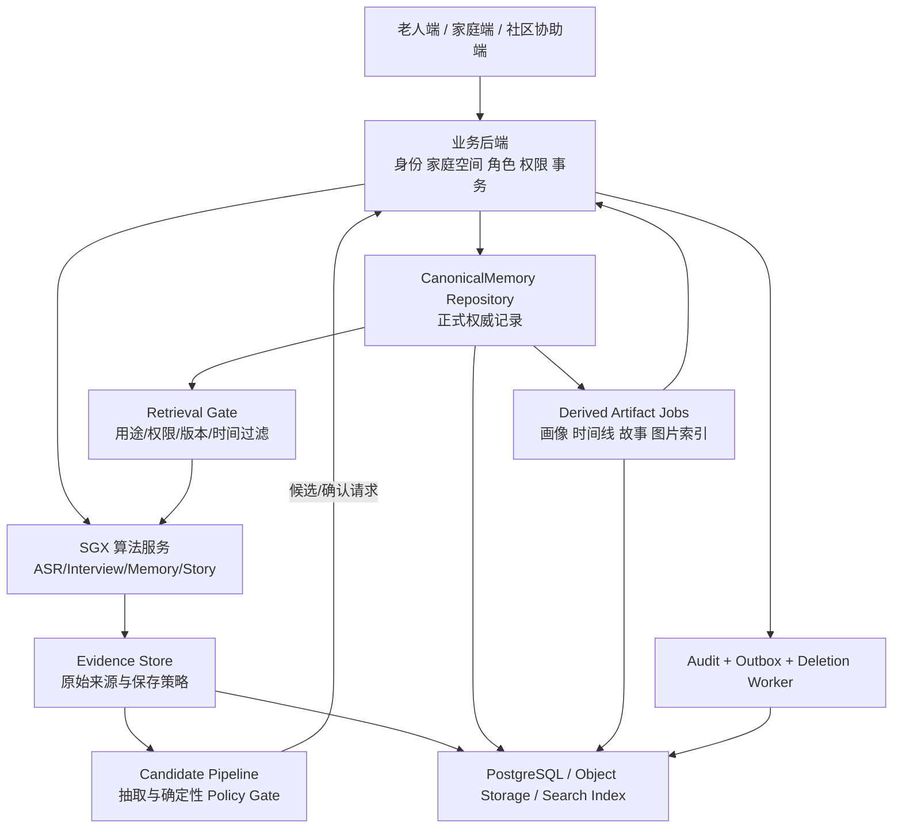
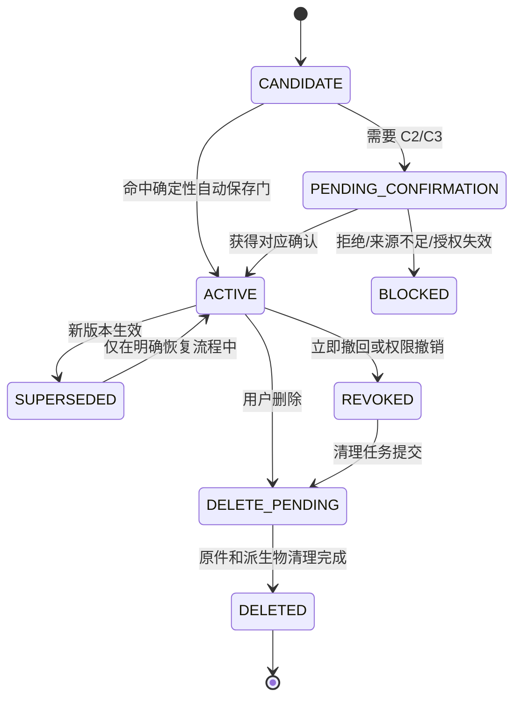

# SGX 正式 CanonicalMemory：架构、数据结构与实现接入计划

> 版本：`canonical-memory-design-v0.1-draft`
> 日期：2026-10-13
> 状态：`M1/M2 语义已确认；正式持久化设计开始；生产写入尚未开启`
> 面向对象：算法负责人、产品、全栈、内容和康养合作方

## 1. 先回答当前最重要的问题

是的，**我们实际设计的 Life Memory，最终要以 `CanonicalMemory` 作为产品当前可使用信息的权威层**。但 `CanonicalMemory` 不是 Memory 算法的全部，而是 Memory 全链路中的一个层：

```text
原始材料 Evidence
    ↓
算法抽取 MemoryCandidate
    ↓
来源、主体、时间、敏感性、权限和用途检查
    ↓
用户确认或符合已批准的自动保存规则
    ↓
CanonicalMemory（当前业务权威）
    ↓
按场景和权限检索
    ↓
访谈、日常聊天、故事、画像和其他派生视图
```

因此，之前的设计并没有被推翻。已经确认的核心原则是：

- 原始音频、原始转写、图片、文字说明和确认记录是来源依据；
- 带来源、版本、确认状态、权限和用途的结构化 Life Memory 是当前可使用信息的业务权威；
- Markdown 画像、时间线、关系图、故事和洞察都是可重建视图；
- 模型只能提出候选或生成派生内容，不能直接写入权威记忆；
- 老人当前意愿、撤回和权限限制优先于“记得更多”；
- 修改不覆盖旧依据，而是创建新版本并局部传播影响。

已经设计并部分实现的是 M1/M2 的语义、政策门和进程内 `ReferenceStore`。**尚未完成的是正式持久化 `CanonicalMemory`、后端事务、账号权限、跨进程检索、删除传播和与当前算法服务的正式接线。**

当前状态仍为：

```text
storage.durable = false
canonicalWriteCapability = false
canonicalWriteCount = 0
```

当前 `ReferenceStore` 是算法闭环验证用的参考实现，不是正式家庭数据库。旧产品的 `MemoryCard` 也不能直接当作新的 `CanonicalMemory`。

## 2. 目标和边界

### 2.1 目标

正式层要支持：

1. 日常聊天、正式访谈、故事、画像和共创按用途检索同一套权威记忆；
2. 每条记录能追溯到“谁在何时表达或提供了什么”；
3. 老人、家庭和社区角色拥有不同且可审计的查看、确认、修改、分享和删除范围；
4. 纠正、撤回、删除后旧内容立即停止被调用，派生内容按依赖增量失效和重建；
5. 并发编辑、网络重试和重复提交不会生成重复或互相覆盖的版本；
6. 算法服务可以继续独立测试，正式后端可以替换当前 Reference Store，而不用重写 InterviewPolicy 和 MemoryPolicy。

### 2.2 本阶段不做的事

- 不把大模型变成数据库写入者；
- 不把所有聊天原文永久保存为长期记忆；
- 不从普通聊天静默推断人格、认知、疾病或家庭矛盾；
- 不把故事、画像或图片反向当作新的事实来源；
- 不把 `memoir-backend` 中 Rongxiu 共创领域的表直接改名充当 Life Memory；
- 不在正式接线前上传真实老人数据。

## 3. 总体架构



职责边界必须固定：

| 模块 | 负责 | 不负责 |
|---|---|---|
| 算法服务 | 识别、抽取候选、来源验证、重要性/敏感性建议、检索排序、访谈使用建议 | 账号登录、家庭成员绑定、最终数据库事务和越权放行 |
| Policy Gate | 判断候选是否可自动保存、需要 C2/C3 确认、只能作为来源陈述或必须阻断 | 自行修改数据库或改变用户授权 |
| 业务后端 | 身份、家庭空间、角色、确认、正式写入、版本事务和接口鉴权 | 代替算法决定内容含义 |
| CanonicalMemory Repository | 保存权威记录、版本指针、状态、来源链接、权限和审计关联 | 生成故事、推断心理或绕过权限 |
| 派生任务 | 画像、时间线、故事、图片计划、搜索索引 | 反写权威事实 |
| 删除/撤回 Worker | 立即阻断调用、异步清理原件和派生物、记录结果 | 擅自恢复已删除内容 |

## 4. 数据结构

### 4.1 Evidence：原始来源

`Evidence` 记录“谁提供了什么”，不是事实结论。

```json
{
  "evidenceId": "ev_01J...",
  "subjectId": "elder_123",
  "familySpaceId": "family_456",
  "sourceActorId": "elder_123",
  "sourceActorRole": "ELDER",
  "kind": "AUDIO_TRANSCRIPT",
  "rawObjectRef": "object://private/...",
  "rawText": "我以前在纺织厂工作。",
  "sourceSpan": {"start": 0, "end": 12},
  "recordedAt": "2026-10-13T10:00:00Z",
  "eventTime": {"value": "1970", "precision": "YEAR", "uncertain": true},
  "allowedPurposes": ["DAILY_CHAT", "FORMAL_INTERVIEW", "STORY_DRAFT"],
  "visibilityScope": ["ELDER_ONLY"],
  "authorizationVersion": "auth_12",
  "useStatus": "ACTIVE",
  "retentionPolicy": "RAW_40_DAYS",
  "contentHash": "sha256:..."
}
```

原始音频、原始转写、整理后的字幕和用户编辑文字分别保存。整理稿不能覆盖原始证据。`sourceSpan` 必须指向连续原文；无法提供连续来源时，候选不能进入权威写入门。

### 4.2 MemoryCandidate：算法候选

当前 `src/lib/memory-runtime/contracts.ts` 的 `MemoryCandidate` 已包含大部分字段，正式接口继续保留：

- `claimId / proposalId`：候选和抽取操作标识；
- `subjectId / familySpaceId / purpose`：主体、家庭空间和当前用途；
- `normalizedClaim / contentType`：结构化陈述及类型；
- `evidenceRefs / sourceActor`：来源和说话人；
- `eventTime / validFrom / validTo / temporalState`：事件时间和有效期；
- `importanceReasons / sensitivityLevel / sensitivityCategories`：重要性和敏感性建议；
- `disposition`：`AUTO_WRITE`、`C2_BATCH_CONFIRM`、`C3_STRONG_CONFIRM`、`SOURCED_ONLY`、`SESSION_ONLY`、`NO_MEMORY`、`BLOCKED`；
- `confirmationBasis / writeEligibility`：确认依据和是否允许进入业务门；
- `allowedUses / forbiddenUses / visibilityScope`：用途和可见范围；
- `conflictState / relationships`：冲突及关系；
- `policyVersion / algorithmVersion / reasonCodes`：可追溯版本；
- `canonicalWritePerformed: false`：模型和算法候选阶段必须保持为 `false`。

候选不等于事实，也不等于已经保存。候选进入正式层必须由业务后端执行确定性写入门或确认流程。

### 4.3 CanonicalMemory：权威记录

建议把稳定的 `logicalMemoryId` 和不可变的版本记录分开：

```json
{
  "logicalMemoryId": "lm_01J...",
  "currentVersion": 3,
  "status": "ACTIVE",
  "subjectId": "elder_123",
  "familySpaceId": "family_456",
  "contentType": "LIFE_EVENT",
  "claim": "曾在纺织厂工作",
  "temporal": {"from": "1970", "precision": "YEAR", "uncertain": true},
  "sourceRefs": ["ev_01J..."],
  "sourceActors": [{"actorId": "elder_123", "role": "ELDER"}],
  "authorityState": "SELF_ASSERTED",
  "confirmationBasis": "POLICY_AUTHORIZED",
  "importanceReasons": ["IDENTITY", "INTERVIEW_CONTINUITY"],
  "sensitivityLevel": "S0",
  "allowedUses": ["DAILY_CHAT", "FORMAL_INTERVIEW", "STORY_DRAFT"],
  "visibilityScope": ["ELDER_ONLY"],
  "retentionPolicy": "UNTIL_SUPERSEDED_OR_REVOKED",
  "version": 3,
  "supersedesVersion": 2,
  "policyVersion": "sgx-m2-policy-v0.1",
  "confirmedBy": "policy:ordinary-self-report-v1",
  "confirmedAt": "2026-10-13T10:01:00Z",
  "createdAt": "2026-10-13T10:01:00Z",
  "updatedAt": "2026-10-13T10:01:00Z"
}
```

权威记录的硬不变量：

1. 没有 `sourceRefs` 的记录不能成为 `ACTIVE`；
2. `sourceRefs` 必须属于同一主体、家庭空间和授权版本，且未撤回；
3. `ACTIVE` 记录必须有明确的 `confirmationBasis`；
4. `S2` 高敏感内容不能由普通自动保存规则激活；凭据等 `S3` 禁止项直接阻断，不进入 `CanonicalMemory`（因此运行时的 `SensitivityLevel` 仍只有 `S0/S1/S2`）；
5. 当前版本只能有一个，旧版本只能被标记为 `SUPERSEDED`、`REVOKED` 或 `DELETED`；
6. 普通检索不能返回待确认、冲突开放、撤回、删除或过期记录；
7. 故事、画像和模型输出没有写入权。

### 4.4 权限、变更和派生依赖对象

正式层还需要以下对象：

| 对象 | 作用 |
|---|---|
| `MemoryAuthorization` | 保存授权人、授权范围、用途、可见范围、版本、开始/结束时间和撤回状态 |
| `MemorySourceLink` | 记录权威版本依赖哪些 Evidence 和连续原文片段 |
| `MemoryChange` | 记录预览、操作者、差异、影响范围、提交状态和幂等键 |
| `MemoryTombstone` | 删除后保留不含正文的逻辑标识、版本、时间和原因 |
| `DerivedDependency` | 记录故事段落、画像字段、时间线节点、检索索引依赖的 Memory 版本 |
| `MemoryAudit` | 记录访问、确认、纠正、撤回、删除、拒绝和失败，不保存不必要原文 |
| `MemoryIdempotency` | 防止网络重试产生重复版本或重复删除任务 |
| `MemoryOutboxEvent` | 将权威提交、撤回、删除和重建任务可靠地交给异步 worker |

## 5. 权限模型

权限同时检查五个维度：`subjectId`、`familySpaceId`、`purpose`、`visibilityScope`、`authorizationVersion`。只有角色匹配不够，还要满足用途和授权版本。

| 角色 | 默认能力 | 明确不能做什么 |
|---|---|---|
| 老人本人 `ELDER` | 查看、确认、纠正、撤回、删除自己的内容；决定是否进入访谈和是否保存 | 不能默认查看其他家庭成员的私密内容 |
| 家庭主管理员 `FAMILY_ADMIN` | 家庭绑定、成员管理、授权范围和协作者管理 | 不能凭管理员身份覆盖老人明确意愿或查看 S2 内容 |
| 指定家庭成员 `FAMILY_DELEGATE` | 在被授权的用途和可见范围内查看、参与共创 | 不能扩大用途、替老人确认高敏感内容 |
| 社区协作人 `COMMUNITY_HELPER` | 只访问被明确共享的访谈/共创材料 | 不能读取家庭私密记忆、健康和财产内容 |
| 算法服务 `ALGORITHM_SERVICE` | 提交候选、按已授权范围检索最小上下文、请求变更预览 | 不能直接提交权威写入、确认、分享或删除 |
| 系统删除 Worker `LIFECYCLE_WORKER` | 按已提交的删除/撤回任务清理和回执 | 不能恢复记录或改变授权 |
| 审计角色 `AUDITOR` | 查看脱敏审计记录 | 不能读取原始正文或修改任何记忆 |

家庭管理员负责成员和权限管理；内容确认按场景授权。老人本人仍然是自己内容的最高意愿来源。若老人授权外部协作人，授权必须限定到家庭空间、用途、字段范围和时间。

## 6. 版本、确认和修改

### 6.1 状态机



### 6.2 修改规则

- 改故事措辞：只创建 `DerivedArtifact` 新版本，不改 CanonicalMemory；
- 改人物、时间、地点、关系或事件：创建新的 CanonicalMemory 版本，旧版本标记 `SUPERSEDED`；
- 增加家属或社区说法：新增 `SourcedClaim`，不覆盖老人来源；
- 改用途或可见范围：创建授权新版本，内容版本可以不变；
- 纠正必须携带 `expectedVersion`，版本不一致返回冲突预览；
- 所有写入和确认携带 `idempotencyKey`，重复请求返回原结果；
- 不使用“最后写入者覆盖”解决并发冲突。

### 6.3 撤回和删除

沿用已经确认的生命周期原则：

1. **立即失效**：撤回或删除命令提交成功后，普通检索、访谈上下文和故事生成立即不能使用目标内容；
2. **24 小时删除**：原始内容、缓存、索引和派生物进入删除队列，目标是在 24 小时内完成或明确失败；
3. **40 天自动到期**：未被长期确认的原始音频、原始转写和临时内容按 40 天策略自动到期；
4. **只留无内容审计记录**：删除完成后保留不含正文的 tombstone、时间、操作者、原因和结果；
5. **外部 provider 删除**：只有收到 provider 的删除回执才把外部清理标成完成，不能用本地删除代替外部删除证明。

撤回先阻断使用，再异步清理，避免清理失败时旧内容继续被使用。删除任务失败时保持 `DELETE_PENDING` 和不可检索状态，支持安全重试。

## 7. 持久化设计

建议复用 `memoir-backend` 已有的 PostgreSQL、Liquibase、事务、Outbox 和 worker 基础设施，在其中新增独立的 `life_memory` bounded context；不新建第二套数据库，不把算法服务进程内 Map 当作生产存储。

建议的最小表集合：

| 表 | 关键字段 | 约束 |
|---|---|---|
| `life_memory_evidence` | evidence、主体、来源、原文对象、用途、授权、保存状态 | 来源和主体不可空；撤回后不可重新激活 |
| `life_memory` | logical id、主体、当前版本、当前状态 | 一个逻辑记忆只有一个当前版本指针 |
| `life_memory_version` | claim、时间、敏感性、确认、用途、版本关系 | 版本不可覆盖；`sourceRefs` 必须存在 |
| `life_memory_source_link` | memory version、evidence、source span | 不能链接跨主体或已撤回 Evidence |
| `life_memory_authorization` | actor、role、purpose、visibility、version、expiry | 授权收窄立即生效 |
| `life_memory_change` | preview、commit、expected version、idempotency | 重试幂等；并发冲突可解释 |
| `life_memory_dependency` | 派生物、依赖 Memory 版本和字段 | 版本变化能计算影响范围 |
| `life_memory_tombstone` | logical id、version、deletedAt、reason | 不保存正文 |
| `life_memory_audit` | actor、action、resource、outcome、requestId | 追加写，不保存不必要原文 |
| `life_memory_outbox` | event type、payload ref、delivery state | 事务内写入，worker 幂等消费 |

写入事务只保证权威记录、版本指针、授权变更、tombstone 和 outbox 一起提交；索引、故事、画像和图片重建异步执行。这样老人不用等待所有派生内容完成，也不会出现“页面说已保存但权威记录没提交”的状态。

## 8. 与当前算法服务的接入

### 8.1 算法侧接口

当前 `/api/algorithm/v0.1` 保留为内部算法测试接口；正式后端接入时使用同样的合同，但由业务后端负责认证和权威写入。

```text
POST /v1/memory/candidates
  Evidence → MemoryCandidate；永远不直接写 CanonicalMemory

POST /v1/memory/retrieve
  subject + purpose + authorization + visibility + query
  → 最小必要的 ACTIVE 记录和来源片段

POST /v1/memory/changes/preview
  candidate/纠正/权限变化 → 差异、影响范围、确认要求

POST /v1/memory/changes/commit
  后端确认后的变更 → canonicalVersion、旧版本状态、outbox 任务

POST /v1/memory/revoke
  立即阻断检索，提交清理任务

GET /v1/memory/jobs/{jobId}
  返回索引、派生物、原件和 provider 清理状态
```

### 8.2 访谈热路径

```text
ASR final
 → Evidence 接入
 → 按 subject/purpose/authorization/visibility 检索 CanonicalMemory
 → InterviewPolicy 选择动作
 → LLM 只负责表达
 → TTS
 → Memory 候选异步抽取
 → 后端确认或自动保存门
 → CanonicalMemory 新版本
```

Memory 检索失败时，访谈仍可用当前轮原话继续；权威写入失败时，系统显示“本轮已完成，整理稍后重试”，不能把候选误报成已保存。撤回、`NO_SAVE` 和敏感权限变化走同步硬门。

### 8.3 运行模式

```text
SGX_CANONICAL_MEMORY_MODE=reference  # 当前默认，进程内，虚构案例
SGX_CANONICAL_MEMORY_MODE=durable    # 后端 Adapter 可用且通过 Gate 后才开启
```

`durable` 模式必须在健康检查中报告：数据库连接、迁移版本、授权服务、Outbox、删除 worker 和索引状态。任一关键依赖不满足时 fail closed：可以继续提供不使用历史 Memory 的聊天，但不能伪装为正式保存成功。

## 9. 实施阶段和门禁

### C0：设计冻结（当前阶段）

- 冻结本文件中的权威模型、边界、生命周期和权限原则；
- 与全栈确认复用 `memoir-backend` PostgreSQL/Liquibase/Outbox；
- 冻结 `CanonicalMemory v0.1` JSON 合同和错误语义；
- 明确旧 `MemoryCard` 只读兼容，不自动迁移为权威记录。

### C1：算法侧合同和端口

- 把 `CanonicalMemoryRepository`、`MemoryRetriever`、`ChangePreview` 和生命周期事件定义为 TypeScript port；
- 保留 Reference Store 作为 Fake/测试 Adapter；
- 添加 durable Adapter 的 HTTP client，但默认关闭；
- 加入版本、幂等、撤回后检索为 0、并发冲突和影响预览测试。

### C2：后端正式持久化

- 在 `memoir-backend` 新增 Liquibase migration、JDBC repository、授权校验、Outbox 和删除 worker；
- 事务提交权威记录、版本指针和审计关联；
- 接入家庭/老人/指定协作者角色；
- 先用虚构主体和内部成年人，不接真实老人。

### C3：算法—后端联调

- `reference` 与 `durable` 双模式同一合同回放；
- 对比候选、确认、检索、纠正、撤回、删除和派生失效结果；
- 通过 staging 数据库和固定案例后，才允许测试工作台显示“正式保存”。

### C4：生产前门禁

- 来源完整率 100%；
- 越权读取/写入 0；
- 撤回后检索残留 0；
- 删除任务可重试且最终有回执；
- 并发冲突不覆盖；
- 幂等重试不重复写入；
- 故事和画像不反写权威层；
- 审计不泄露正文和凭据；
- 迁移、备份、恢复和回滚演练通过。

## 10. 现在已经完成和还没有完成的部分

| 部分 | 状态 |
|---|---|
| M1 权威层语义和原始依据边界 | 已确认 |
| M2 重要性、敏感性、确认和自动保存规则 | 已形成并有 policy 实现 |
| MemoryCandidate 合同和来源校验 | 已实现 |
| 进程内 Reference Store | 已实现，供算法闭环验证 |
| 正式 CanonicalMemory 数据库 | 未实现 |
| 后端权限与家庭角色接入 | 未接入算法主链 |
| 持久化版本/幂等/并发 | 设计待实现 |
| 撤回/删除 24 小时清理和外部 provider 回执 | 设计待实现 |
| 访谈从正式 CanonicalMemory 检索 | 当前只使用测试 Reference Store |
| 真实老人数据验证 | 未开始 |

## 11. 需要负责人确认的四个重大决策

以下决策会影响后端实现，建议采用推荐项：

1. **权威存储位置**：推荐复用 `memoir-backend` 的 PostgreSQL/Liquibase/Outbox，由全栈后端持有最终写入权；算法服务通过合同提交候选和检索请求。
2. **旧 MemoryCard 迁移**：推荐先只读兼容，不自动批量迁移；由老人或业务流程重新确认后再生成 CanonicalMemory 版本，避免把旧字段当成新来源。
3. **原始内容生命周期**：推荐继续采用“撤回立即失效、24 小时内清理、未确认原始内容 40 天到期、删除后仅留无内容审计”；长期结构化记忆保留到被替代、撤回或删除。
4. **首版自动保存白名单**：推荐只允许本人直接表达的普通兴趣、沟通偏好和低风险生活习惯；健康、认知、财产、家庭冲突、第三人隐私、精确位置和任何模型推断都必须走确认或阻断。

负责人确认这四项后，算法侧可以立即执行 C1，不需要等待完整产品页面；C2 的数据库迁移和后端写入仍需要全栈按同一合同实施和验收。

## 12. 权威入口和后续关联

- [Life Memory 与访谈顶层架构](./2026-09-22-sgx-life-memory-interview-top-level-architecture-and-decisions.md)
- [Interview 与 Life Memory 最新实现](../execution/2026-10-02-interview-memory-runtime-integration-plan.md)
- [算法版本入口](./README.md)
- [产品/算法/全栈协作说明](../handoffs/2026-10-12-algorithm-product-fullstack-dify-coordination-brief.md)
- [2026-10-13 执行记录](../execution/2026-10-13-execution-log.md)
