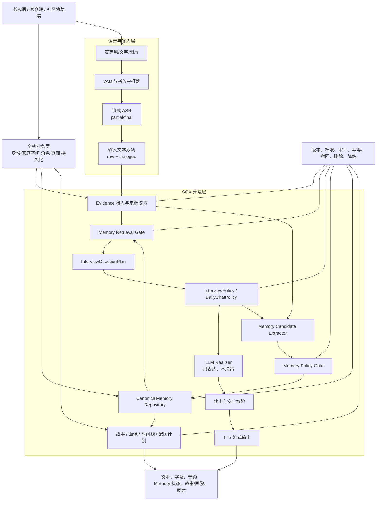

# SGX 整体算法系统：架构、输入处理、完整链路与下一步设计计划

> 日期：2026-10-13
> 版本：`algorithm-system-overview-v0.1`
> 状态：`top-level-design-aligned / modular-runtime-partial / durable-canonical-pending`
> 用途：帮助负责人、产品、内容、全栈和康养合作方理解“用户输入怎样进入算法、算法怎样决策、最终输出什么，以及哪些能力已经实现”。

## 1. 先回答最重要的问题

SGX 的算法不是一个大模型接口，而是一条由多个受控模块组成的流水线：

```text
用户输入
→ 语音/文字/图片等输入处理
→ 当前会话和权限确定
→ Evidence 原始依据保存
→ Memory 检索与访谈状态判断
→ InterviewPolicy 或 DailyChatPolicy 决定动作
→ 文本模型只负责把已批准的动作表达出来
→ 校验、TTS 播放和智能打断
→ 异步生成 Memory 候选
→ 自动保存门或人工确认
→ CanonicalMemory 权威记录
→ 故事、画像、时间线和配图等派生内容
→ 页面展示、用户反馈和质量评估
```

其中三件事必须始终分开：

1. **模型输出不等于算法决策**：模型不能自行决定是否追问、保存、分享或删除。
2. **Memory 候选不等于权威记忆**：模型只能提出候选；通过 Policy Gate 和业务确认后才可能进入 `CanonicalMemory`。
3. **展示文字不等于原始证据**：字幕、整理稿、故事和画像都可以重算，不能覆盖原始语音、原始转写和来源。

`CanonicalMemory` 是 Life Memory 的业务权威层，但不是 Memory 全部，也不是当前所有算法已经完成的证明。当前进程内 `ReferenceStore` 仍为 `durable:false`，正式数据库和正式家庭权限尚未接入。

## 2. 总体架构

首版可以部署为一个算法服务进程，不必立刻拆成多个微服务；但代码、数据合同和日志必须按下面的逻辑模块隔离。



算法侧负责：输入处理、来源校验、访谈动作、Memory 候选、检索排序、文本表达约束、TTS/VAD 适配、Fake、HTTP 合同和实验评估。全栈负责：登录、家庭空间、成员绑定、正式数据库、页面、业务权限、数据删除执行和产品部署。两侧共同验收老人实际体验。

## 3. 所有输入分成六层

### 3.1 用户内容输入

| 输入 | 例子 | 首要处理 | 原始内容是否保留 |
|---|---|---|---|
| 语音流 | 老人讲一段经历 | VAD、流式 ASR、分段、partial/final | 保留原始音频引用和最终转写 |
| 文字 | 老人直接输入或家人补充 | 文本规范化、来源标注、敏感性检查 | 保留原文 |
| 图片/照片 | 老照片、物件、家庭照片 | 图片引用、说明、人物/时间候选 | 保留原图和上传者说明 |
| 用户编辑 | 老人或获授权协作者纠正 | 生成修订版本和差异 | 保留旧版本，不静默覆盖 |
| 控制指令 | 停止、换题、别保存、以后别提 | 作为高优先级 Policy 输入 | 必须立即记录控制意图 |
| 反馈 | 点赞、不好、修改故事 | 记录质量信号，不能直接改变事实 | 保留反馈与对应版本 |

### 3.2 会话和运行输入

每次调用都必须带有或由服务端可信解析出：

```json
{
  "sessionId": "session_123",
  "sessionEpoch": "epoch_4",
  "turnId": "turn_08",
  "generationId": "gen_19",
  "responseId": "resp_19",
  "mode": "DAILY_CHAT",
  "asrStatus": "FINAL",
  "evidenceRefs": ["ev_08"],
  "subjectId": "elder_123",
  "familySpaceId": "family_456",
  "purpose": "DAILY_CHAT",
  "authorizationVersion": "auth_12",
  "visibilityScope": ["ELDER_ONLY"]
}
```

这些字段不是给模型自由填写的。客户端只能提交最小身份，`subjectId`、家庭空间、授权版本和可见范围由服务端会话解析器确定。`sessionEpoch` 防止旧会话结果污染新会话；`generationId/responseId` 防止打断后的迟到文本或音频继续投递；`evidenceRefs` 保障每个结果能追溯来源。

### 3.3 语音运行信号

- `VAD`: 是否存在语音活动、是否确认真人开始说话、是否误触发；
- `ASR PARTIAL`: 还在说，不能触发 Memory 写入和最终回答；
- `ASR FINAL`: 本轮输入结束，才允许进入最终 Policy；
- 网络、Provider、超时和取消状态；
- TTS 播放状态、当前 generation 和用户插话状态。

这些信号用于交互控制，不直接变成老人性格、健康或认知结论。

### 3.4 历史上下文输入

历史内容只能通过 `Memory Retrieval Gate` 进入当前模块。检索同时检查：

```text
subjectId
+ familySpaceId
+ purpose
+ authorizationVersion
+ visibilityScope
+ Memory 状态
+ 时间有效性
+ 禁谈和 no-save 规则
```

不能把完整画像、所有历史聊天或所有家庭资料直接塞入模型上下文。

### 3.5 产品目标输入

算法还需要知道用户当前做什么：

- 普通日常聊天；
- 正式“聊往事”访谈；
- 生成故事草稿；
- 生成基础画像；
- 处理照片说明；
- 纠正、撤回、删除或修改权限。

产品目标决定允许使用哪些 Memory、输出什么格式和是否需要确认。它不能由模型自行猜测。

### 3.6 反馈和评估输入

每轮应同时记录：

- 原话、ASR raw、dialogueText；
- AI 文本、TTS 状态、是否被打断；
- InterviewPolicy 动作及原因；
- 检索了哪些 Memory；
- 产生了哪些候选、是否进入确认；
- 故事/画像是否生成；
- 算法工程师、产品/内容团队、康养专家和用户的反馈。

反馈是评估证据，不应直接覆盖算法事实或隐藏失败。

## 4. 一轮语音或文字交互的完整流程

### 第 0 步：进入会话和授权

业务后端建立会话，确认用户、家庭空间、角色、用途、保存偏好和当前授权版本。正式访谈必须由老人点击“聊往事”或明确同意进入；普通聊天不能静默切换为正式访谈。

### 第 1 步：VAD 和智能打断

VAD 先判断是否可能有人说话；确认真正开始说话后：

1. 暂停当前 TTS 播放；
2. 使旧 `generationId/responseId` 失效；
3. 取消或停止旧文本和音频流；
4. 丢弃旧 AI 输出的迟到片段；
5. 不删除上一轮已经完成且合法的 Evidence；
6. 如果用户发出 no-save、撤回或结束命令，立即取消对应异步 Memory 作业。

页面停止播放不等于服务端取消完成。必须收到 provider/运行时的停止确认，才能把打断标记为安全完成。

### 第 2 步：流式 ASR

ASR 产生 partial 和 final：

```text
音频分包 → partial 转写 → 用户继续说 → final 转写 → Evidence
```

ASR 只负责“听写”和时间/分段信息，不负责文章润色、访谈决策或认知判断。关键的人名、数字、日期、地点、否定词和不确定表达必须单独保真检查。

### 第 3 步：输入文本双轨处理

保留两份文本：

| 文本 | 用途 | 是否可覆盖 |
|---|---|---|
| `rawTranscript` | 来源、Memory 引用、未来语音/认知分析、审计 | 不可覆盖 |
| `dialogueText` | 字幕、普通对话、访谈表达和候选抽取 | 可重算、有版本 |

短文本中可以删除句首独立的“嗯、呃、额、那个”等填充词和重复标点；否定、纠正、不确定词、数字、人名、时间、控制指令和句末语气不能随意删除。整理器不读取语速、音高等认知信号，也不向认知干预算法输出结论。

### 第 4 步：建立 Evidence

Evidence 表达的是“谁在什么时间通过什么渠道提供了什么”，而不是模型已经得出的事实：

```json
{
  "evidenceId": "ev_08",
  "subjectId": "elder_123",
  "sourceActorId": "elder_123",
  "sourceActorRole": "ELDER",
  "kind": "AUDIO_TRANSCRIPT",
  "rawText": "我以前在纺织厂工作。",
  "dialogueText": "我以前在纺织厂工作。",
  "sourceSpan": {"start": 0, "end": 12},
  "recordedAt": "2026-10-13T10:00:00Z",
  "allowedPurposes": ["DAILY_CHAT", "FORMAL_INTERVIEW", "STORY_DRAFT"],
  "authorizationVersion": "auth_12",
  "useStatus": "ACTIVE"
}
```

### 第 5 步：检索允许使用的 Memory

当前轮不会读取全部历史，只读取符合当前用途、权限和状态的最小引用。例如正式访谈可以使用已确认的相关人生事件，但普通日常聊天不应自动带出健康、家庭冲突或财务信息。

撤回、删除、过期、冲突开放、no-save 和禁谈内容在这一层被过滤。检索失败时，当前轮仍可以只依据老人本轮原话继续，不应把“没有历史 Memory”报成系统错误。

### 第 6 步：决定是日常聊天还是正式访谈

先判断模式，再执行对应策略：

| 模式 | 负责模块 | 主要目标 |
|---|---|---|
| `DAILY_CHAT` | `DailyChatPolicy` | 自然回应、少量低压力追问、使用有限偏好 |
| `FORMAL_INTERVIEW` | `InterviewDirectionPlan` + `InterviewPolicy` | 在老人意愿下推进人生回忆，决定承接、追问、澄清、换题、暂停或结束 |

正式访谈的方向由五层共同控制：产品/康养目标、老人当前意愿、DirectionPlan、InterviewPolicy、LLM Realizer。Memory 只提供有来源的线索，不替代访谈方向。

### 第 7 步：InterviewPolicy 先于 LLM

Policy 接收本轮原话、当前主题、访谈状态、VAD/ASR/TTS 状态、允许的 Memory 和控制指令，输出结构化 `NextAction`：

```json
{
  "interactionAction": "WAIT",
  "interviewAction": "FOLLOW_UP",
  "utterancePlan": {
    "intent": "承接纺织厂工作线索并追问一个具体片段",
    "questionCount": 1,
    "mustAvoid": ["把未确认事件说成事实", "一次提多个问题"]
  },
  "retentionControl": {
    "intent": "ALLOW_CANDIDATE_EXTRACTION",
    "cancelPendingExtraction": false
  },
  "runtimeControl": {
    "sessionEpoch": "epoch_4",
    "generationId": "gen_19",
    "delivery": "EMIT"
  },
  "reasonCodes": ["NEW_LIFE_EVENT_DETAIL"]
}
```

它的优先级通常是：结束/停止 → 高风险安全 → 明确结束 → 插话和 partial → 技术恢复 → 不保存/禁谈/隐私 → 拒绝/疲劳/换题 → 正常承接和追问。

### 第 8 步：LLM 只负责自然表达

文本模型收到的是已批准的 action、允许使用的来源和表达约束。它可以把策略变成适合老人的话，但不能改变：

- 是否追问；
- 当前主题和禁谈范围；
- 问题数量；
- 是否保存或不保存；
- 哪些 Memory 可以被使用；
- 是否结束、暂停或取消。

“我听清楚了”只在确需确认、ASR 有歧义或老人询问时使用。普通叙述应直接承接具体线索，避免固定模板。

### 第 9 步：回复校验和降级

在播放前检查：

- JSON/字段结构是否正确；
- 问题是否最多一个；
- 问题是否位于句末；
- 是否出现未确认事件前提；
- 是否编造人物感受、成就、地点、日期或关系；
- 是否违反禁谈、no-save、用途和当前 generation；
- 是否声称已经保存、删除或分享；
- 是否把故事/画像请求误当成聊天答案。

失败时优先使用当前 Policy 的受控 fallback；如果当前 generation 已失效，直接丢弃，不允许迟到输出复活。

### 第 10 步：TTS 和输出

输出至少包含：

```json
{
  "text": "好的，您以前在纺织厂工作。那里有没有一位让您印象特别深的人？",
  "captionText": "好的，您以前在纺织厂工作。那里有没有一位让您印象特别深的人？",
  "audio": {
    "status": "STREAMING",
    "mimeType": "audio/mpeg",
    "responseId": "resp_19"
  },
  "turnId": "turn_08",
  "policyVersion": "sgx-interview-policy-v0.2"
}
```

字幕和语音使用同一份通过校验的 `spokenText`。用户插话时停止旧音频，新的语音不应与旧音频重叠；TTS 失败时允许显示文字，但必须明确音频失败状态。

### 第 11 步：异步生成 Memory 候选

当前轮完成后，若没有 no-save、撤回或取消信号，Memory 流程异步运行：

```text
Evidence
→ must-extract 安全下限
→ 真实 semantic provider
→ sourceSpan 连续原文校验
→ 去重/合并/冲突检查
→ M2 Memory Policy
→ MemoryCandidate
```

Memory Candidate 必须带有：`subjectId`、`familySpaceId`、`purpose`、`evidenceRefs`、`sourceActor`、时间、不确定性、重要性理由、敏感性、允许用途、可见范围、确认依据、策略版本和算法版本。

### 第 12 步：自动保存或确认

模型不能直接写 `CanonicalMemory`。候选分为：

- 低风险、本人直接表达、已预授权、无冲突、可纠正：进入确定性自动写入门；
- 普通重要内容：进入 C2 批量确认；
- 健康、认知、财产、家庭冲突、第三方隐私等：进入 C3 强确认或仅保留来源陈述；
- 凭据、验证码、完整账号等：阻断，不进入通用 Memory；
- 仅当前操作意图：只留会话级，不写长期记忆。

### 第 13 步：进入 CanonicalMemory 或保留为候选

正式 `CanonicalMemory` 是版本化权威记录：

```text
CANDIDATE
→ PENDING_CONFIRMATION
→ ACTIVE
→ SUPERSEDED / REVOKED
→ DELETE_PENDING
→ DELETED
```

每次纠正创建新版本，旧版本保留关系；撤回先立即阻断检索，再异步清理原始内容、缓存、索引和派生物。当前正式 PostgreSQL Adapter 尚未完成，当前算法服务仍使用进程内 Reference Store 做闭环验证。

### 第 14 步：生成故事、画像和配图

故事、基础画像、时间线和配图计划都是 `DerivedArtifact`：

- 只能读取当前用途允许的 `ACTIVE` Memory 和 Evidence；
- 每段或每个字段保存 `sourceRecordIds/sourceEvidenceRefs`；
- 不反向写入 CanonicalMemory；
- 来源被纠正、撤回或删除后，派生物标记过期并重建；
- 默认文章风格是平白、温情、少改写；
- 用户没有提供图片描述时，只生成低具象的温暖纪实插画计划，不补写历史事实；
- 配图不能反过来成为人物身份、时间或事件的新证据。

## 5. 各算法模块的输入、输出和边界

| 模块 | 输入 | 输出 | 允许做什么 | 明确不能做什么 |
|---|---|---|---|---|
| VAD/打断 | 音频流、播放状态、用户插话 | speech start/stop、interrupt、取消信号 | 控制播放和代际 | 不做语义理解和健康判断 |
| ASR | PCM/音频引用、语言、分段配置 | partial/final 转写、时间、置信信息 | 听写和分段 | 不润色、不访谈、不写 Memory |
| DialogueNormalizer | raw 转写、文本类型 | dialogueText、操作记录、歧义标记 | 轻量去口语填充词和标点 | 不删除否定、不改变事实、不看认知信号 |
| DailyChatPolicy | 当前输入、有限 Memory、会话状态 | 日常回应计划 | 控制承接、低压力追问 | 不进入正式访谈、不写长期记忆 |
| InterviewDirectionPlan | 访谈目标、主题账本、老人方向、相关 Memory | 当前主题和候选方向 | 决定长期方向和接续 | 不绕过老人意愿 |
| InterviewPolicy | 原话、ASR/VAD、主题、状态、控制指令 | NextAction、约束、取消/保存控制 | 决定本轮动作和安全底线 | 不生成长文、不写 CanonicalMemory |
| LLM Realizer | NextAction、获准来源、语言偏好 | 结构化回复文字 | 自然表达 | 不改变 action、问题数、用途和保存决定 |
| MemoryExtractor | Evidence、允许范围、现有记录 | 原子候选 proposal | 提取事实候选并给出 sourceSpan | 不确认事实、不直接写库 |
| MemoryPolicy | proposal、来源、权限、敏感性、冲突 | MemoryCandidate、disposition | 判断自动写/C2/C3/阻断 | 不生成故事和诊断 |
| CanonicalMemory | 候选、确认、纠正、授权 | 版本化权威记录和可检索状态 | 持久化、版本、权限、撤回删除 | 不让模型自由写入 |
| Retrieval | 主体、用途、权限、查询 | 最小必要的获准 Memory 引用 | 控制上下文范围 | 不返回越权、撤回或冲突内容 |
| Story/Profile/Image | 获准 Evidence/Memory、用户描述、风格 | 文章、画像、配图计划 | 生成可审阅的派生内容 | 不反写事实、不自动公开 |
| TTS | 校验后的 spokenText、voice 配置 | 流式音频、时延、usage | 播放和取消 | 不自行改写文本和问题 |
| 评估/审计 | 全链路事件、用户反馈 | 指标、失败、版本证据 | 评估质量和定位问题 | 不删除失败、不把局部绿测当整体通过 |

## 6. 当前版本和实现状态

| 能力 | 当前主线版本 | 当前状态 | 真实能力边界 |
|---|---|---|---|
| ASR | 豆包流式 ASR Adapter | 已有真实固定合成样例复验 | 真实成年人、噪声、方言、低音量和自然停顿仍需验证 |
| VAD/打断 | 浏览器 VAD + generation/Abort 取消 | 代码和局部运行证据已有 | 真实设备、回声、自然插话和听感仍需真人验证 |
| 输入整理 | `DialogueNormalizer v0.1` | 确定性合同已实现 | 不能推断认知/健康；真实 ASR 错词下需验证 |
| 访谈动作 | `InterviewPolicy v0.2`，运行延续策略 `v0.3.3` | 本地策略门和真实固定场景已有 | DirectionPlan 的主题排序、跨会话完成判据仍不完整 |
| 访谈表达 | `InterviewRealizer v0.1` | Policy 先于 LLM、fallback 和校验已有 | 真实老人语言泛化和自然度仍需人工评审 |
| Memory 抽取 | `hybrid-v0.2.x` | must-extract + semantic provider 接口已有 | 真实 semantic provider 的 sourceSpan 质量仍需验证 |
| Memory 权威层 | `CanonicalMemory` 设计 + `ReferenceStore` | 参考闭环有；正式持久化没有 | `durable=false`，不能宣称家庭长期库已完成 |
| 故事/画像 | `derived-artifact-runtime v0.3` | 来源、权限、撤回和局部失败隔离已有 | 真实故事质量、持续编辑和生产存储仍需验证 |
| 配图 | `ImagePlan v0.1` | provider-neutral 计划已有 | 生图供应商、人物连续性和发布权限未完成 |
| 全链路 | Turn Orchestrator / HTTP 工作台 | 真实固定案例可跑，部分 G5 能力仍在完善 | 尚未完成 durable CanonicalMemory、完整父子任务和真人验收 |

因此当前准确表述是：**算法的核心机制和不少本地/真实固定输入证据已经存在，但还没有完成“正式持久化 + 全部真实环境 + 真人质量验收”的最终算法闭环。**

## 7. 为了把算法设计好，必须按什么顺序做

### A. 先冻结产品目标和边界

明确首版最重要的是：日常交流连续性、正式人生访谈、Memory 准确沉淀，还是故事生成展示。三类都要做，但必须确定每一阶段的第一优先级和可暂缓项。否则访谈会追求覆盖率，Memory 会追求保存量，故事会追求文采，三者互相拉扯。

### B. 冻结统一数据合同

先冻结 `sessionEpoch/turnId/generationId/responseId/evidenceRef`、ASR partial/final、Evidence、MemoryCandidate、CanonicalMemory、DerivedArtifact 和错误状态。合同先于模型和数据库，确保换豆包、换文本模型或换全栈实现时行为不漂移。

### C. 把访谈拆成“方向”和“逐轮动作”

必须补齐：

- `InterviewProgram`：产品和康养专家确认的目标、主题目录和红线；
- `SessionPlan`：本次访谈希望完成什么、是否生成故事、负担预算；
- `PlanState`：已聊、待聊、跳过、禁谈、下次接续；
- `InterviewPolicy`：本轮等待、承接、追问、澄清、换题、暂停和结束。

这样可以避免把“下一句怎么问”误当成“整场访谈方向”。

### D. 用真实案例校准 Memory，而不是只看 Schema

需要建立包含普通偏好、历史事件、模糊时间、人物关系、纠正、冲突、健康和不保存的 fresh blind set。每条候选都评估：

- 来源是否连续可验证；
- 事实是否被过度扩写；
- 时间是否被错误压成现在；
- 重要性和敏感性是否适当；
- 是否应该自动写、批量确认、强确认或阻断；
- 检索时是否只被允许的场景使用。

不能用模型自己生成的答案当唯一金标准。

### E. 将用户体验指标和算法指标分开

算法指标包括：ASR 关键事实保真、Policy 硬门错误、Memory 来源完整率、误写率、撤回后残留、检索越权、版本冲突、TTS 首音频和取消时延。

用户体验指标包括：老人是否听懂、问题是否有价值、等待是否可接受、能否自然打断、是否觉得被盘问、Memory 是否“像我”、故事是否愿意保留。技术成功不能代替老人体验通过。

### F. 再接正式持久化和全栈

正式数据库必须复用统一后端，新增 Life Memory bounded context；先用虚构主体和内部成年人完成迁移、幂等、并发、权限、撤回和删除测试，再允许真实老人数据。算法服务只通过 Repository/HTTP 合同接入，不能拿数据库连接或直接改产品表。

### G. 最后进行分阶段真人验证

顺序应为：

```text
固定文字回放
→ 固定合成音频协议复验
→ 内部成年人真实语音
→ 内部成年人自然打断/噪声/长停顿
→ 团队和康养专家评审
→ 受监督的目标老人体验
→ 逐步扩大范围
```

每阶段保留失败和降级，不用重采样挑最好结果，也不把上一版本通过次数拼到新版本。

## 8. 当前最应该推进的任务

按依赖和返工风险，下一阶段建议只推进以下七件事：

1. **冻结统一输入/输出合同**：尤其是 turn identity、ASR final、取消和 Evidence 引用。
2. **接入主题账本与完成评估纯规则**：主题账本、自然停顿、USABLE/RICH 和资源上限的独立入口已经存在，下一步接入 Session/HTTP 编排并做真实模型复验。
3. **接真实 semantic provider**：要求逐字连续 `sourceSpans`，保留 provider 原始候选和拒绝诊断。
4. **完成正式 CanonicalMemory C2**：PostgreSQL、版本 CAS、权限、幂等、撤回、删除和 outbox；这仍是独立门禁，当前不打开正式写入。
5. **完成 G5 Turn Orchestrator**：让 ASR、Policy、LLM、TTS、Memory、故事/画像各自失败时互不污染。
6. **建立一套可读的工作台评审结果**：每轮展示原话、AI 回复、追问原因、调用的 Memory、沉淀候选、故事/画像和用户/团队反馈。
7. **再做内部成年人真实语音和智能打断**：不提前进入老人访谈，也不把固定虚构案例当成真实老人效果。

## 9. 负责人现在只需要关注的决策

负责人已经确认首版组合：访谈 `1C`、Memory 保存 `2A+B+D`、检索 `3D`、完成标准 `4D`。当前只需在阅读操作规格后，对会改变验收口径的参数和例外提出修改：

1. 首轮 `20 分钟 / 12 个提问 / 连续追问深度 2` 是否需要在内部 baseline 后调整；
2. R1/R2/R3 的实际检索数量是否需要通过真实模型和团队体验校准；
3. 主题目录和康养专家评审是否需要增加、合并或改名；
4. CanonicalMemory C2 的后端迁移仍按独立数据库、权限和删除门禁推进。

如果没有新的反例，算法可以按操作规格直接进入规则接线和小规模真实模型复验，产品和全栈只需依据同一份合同接入，不需要重新理解模型内部 Prompt。

## 10. 当前权威入口

- [算法版本入口](./README.md)
- [Life Memory 与访谈顶层架构](./2026-09-22-sgx-life-memory-interview-top-level-architecture-and-decisions.md)
- [模块化运行接入方案](../execution/2026-10-02-interview-memory-runtime-integration-plan.md)
- [ASR、输入整理、文章与配图设计](./2026-10-12-asr-input-and-article-image-generation-design.md)
- [正式 CanonicalMemory 架构与接入计划](./2026-10-13-canonical-memory-formal-architecture-and-implementation-plan.md)
- [产品和内容团队阅读包](../handoffs/2026-10-12-interview-memory-team-reading-pack.md)
- [今日执行记录](../execution/2026-10-13-execution-log.md)
