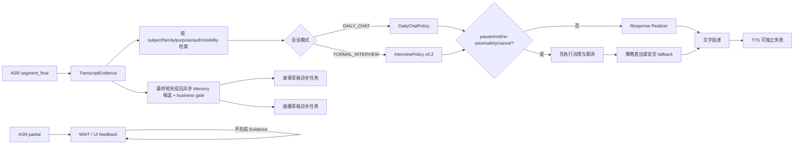

# G5 Turn Orchestrator 与 HTTP/Fake 设计门禁

> 日期：2026-10-03
>
> 状态：`design_frozen / local_implementation_exists / fixed_fixture_gate_not_reverified_in_this_turn / real_e2e_pending`
>
> 固定样例：[g5-fixtures.json](./g5-fixtures.json)
>
> 上游：[执行计划 v0.1](../../../docs/execution/2026-10-02-live-model-baseline-execution-plan.md) · [G1](./G1_REPORT.md) · [G2](./G2_REPORT.md) · [G3](./G3_REPORT.md) · [G4](./G4_REPORT.md)

## 1. 本门禁解决什么

G5 把 G1–G4 已有的独立模块装进一个可取消、可追溯、可交给全栈调用的 Turn Orchestrator，并冻结 HTTP/Fake 的验收合同。它要证明的是：在 **0 元、无网络、纯虚构数据** 条件下，24 个最终轮次和 10 次服务端接受的打断能按预期编排，旧输出不会泄漏，Memory、故事或画像局部失败不会拖垮对话。

本文件仍是 Design Gate，不代替实现报告。仓库现在已有 Turn Orchestrator、六条 HTTP route、G4 bridge 和聚焦测试；本轮只核对了模式切换的数据流，没有据此宣称 24 轮＋10 次打断的 Local Gate 已重新关闭。真实豆包整链、真实老人体验、生产部署稳定性和科学效果仍未证明。

## 2. 权威输入与冻结哈希

| 输入 | SHA-256 | 本轮用途 |
|---|---|---|
| `manifest.json` | `3e23e2e148082a318a44da725045346914dac2113a67f02c1b4a2d3fad9fb18d` | 权威分母、预算、重试、生命周期和 hard stop |
| `scenarios.json` | `2b9c506194cf07955874d976333ff5ae4574003b0af8ef6c286b99194b1b6631` | S01–S08 固定场景 |
| `g3-fixtures.json` | `d33f31bc87e64a973cb60dee679b0a6a81f2788db1783abfae9b0fe66600100e` | Provider/ASR Fake、打断和迟到结果语义 |
| `g4-fixtures.json` | `6d5ec3f3d7cc623eb1e3686e00fe351b497fe6757cd69dde15814dfd0819adeb` | Chat/Interview/TTS/故事/画像合同 |
| `g5-fixtures.json` | `9304b9199c5517cec3d5b3e9a73db3fe5a43f8848442bf9c53d3b71a63158064` | 本轮 24 轮、10 次打断及 HTTP 验收真值 |

实现和测试启动时必须重新计算前四项哈希；任一不一致都应停止，并先重新评审本设计。`g5-fixtures.json` 修改后也必须更新本表及测试快照，不能静默改变分母。

本轮没有引入生产依赖或复制第三方代码。G5 Worker 在选择 HTTP 框架、transport 或状态存储实现前，仍需完成项目要求的 Source Gate：优先核对仓库已有能力，再记录候选开源项目 URL、license、改造范围和不采用自研替代品的理由。

## 3. 上游合同及 G5 边界

| 上游 | G5 可以依赖的合同 | G5 不能外推的结论 |
|---|---|---|
| G1 Algorithm Runtime | attempt ledger、最大 4 attempts、费用暴露、generation lease、取消和迟到拒绝 | 不证明真实 provider 只有一次物理 HTTP |
| G2 Interview/Memory | `InterviewPolicy` 先于 LLM；Memory policy、Reference Store、确认/纠正/撤回/删除和检索门 | 模型候选不能直写 `CanonicalMemory` |
| G3 Provider/ASR | 四类 Fake、ASR partial/final、segment 去重、重连、旧 generation 拒绝 | partial 不能形成 Evidence 或触发 Memory |
| G4 Response/Derived | Daily/Interview 隔离、Policy-bound Realizer、TTS、Story/Profile provenance、受控取消 | 模块绿测不等于整链路隔离或真实语义质量 |

G5 的责任是编排、身份绑定、父子生命周期、HTTP/Fake、幂等、可观察性和跨模块故障隔离。正式产品账号、家庭成员管理、正式数据库、UI、部署和生产监控仍由全栈负责。

## 4. 固定编排顺序

关键约束：

1. `ASR partial` 只用于界面反馈和打断判断；Memory spy、故事、画像调用均为 0。
2. 只有 active connection、active `sessionEpoch` 和 active `generationId` 的唯一 `segment_final` 才能形成一个 `TranscriptEvidence`。
3. 正式访谈必须先重算 `InterviewPolicy`，LLM 只能表达决定，不能改变方向、禁谈、暂停、结束、保存或删除决定。
4. `pause/end/no-save/safety/cancel` 在 LLM、TTS 和异步任务之前生效；撤回会提升 authorization version，使旧任务即刻失去提交资格。
5. Memory 只产生候选并经过 business gate；故事、画像只产生带来源的草稿。三者都没有 canonical write 能力。
6. 一个 turn root lease 管理 Response、TTS、Memory、Story、Profile 子任务。子任务完成不能终止父级或兄弟；父级取消必须递归取消所有后代。

可观察状态至少覆盖：`idle → connecting → listening → user_speaking → thinking → assistant_speaking`，并显式支持 `interrupted / recovering / error / ended`。状态变化只能由服务端可信事件驱动。

## 5. 固定分母

权威 `manifest.json` 冻结为：

| Session | 最终轮次 | 服务端接受的打断 | 目标 |
|---|---:|---:|---|
| E2E-01 | 10 | 4 | 日常聊天进入正式访谈，再生成 Memory、故事和画像 |
| E2E-02 | 8 | 3 | 不确定、冲突、纠正、撤回与删除传播 |
| E2E-03 | 6 | 3 | 疲劳、安全、no-save、Provider 故障与恢复 |
| **合计** | **24** | **10** | 固定分母不可缩减 |

10 次打断对五个阶段各覆盖 2 次：`ASR_PARTIAL / MODEL_PENDING / PRE_TTS / TTS_STREAMING / ASYNC_JOBS`。

### 5.1 E2E-01：10 轮

| Turn | 模式 | 固定输入要点 | 核心预期 | Interrupt |
|---|---|---|---|---|
| G5-E2E01-T01 | Daily | 周日去花市、喜欢兰花 | Daily 回复；兴趣候选；无故事/画像 | — |
| G5-E2E01-T02 | Daily | partial 后重说“字幕大一点” | 只用 replacement final；partial Memory=0；该偏好不硬塞入现有画像路径 | INT-01 ASR partial |
| G5-E2E01-T03 | Daily | 只指本周日，不是每周 | `SESSION_ONLY`；不得写成长期习惯 | — |
| G5-E2E01-T04 | Interview | 明确进入纺织厂往事 | 模式明确切换；模型 pending 被取消 | INT-02 model pending |
| G5-E2E01-T05 | Interview | 初进厂下雨，年份未知 | 一次追问；年份保持未知 | — |
| G5-E2E01-T06 | Interview | 师傅给旧雨衣 | 文字可保留；pre-TTS 取消后无音频 | INT-03 pre-TTS |
| G5-E2E01-T07 | Interview | 1978 年婚礼照片并请求记住 | 带图片来源的候选；仅 elder 可见 | — |
| G5-E2E01-T08 | Interview | 一次只问一个问题 | interaction pace 画像候选；流式 TTS 被打断 | INT-04 TTS streaming |
| G5-E2E01-T09 | Interview | 请求故事草稿 | 逐句 provenance；未知事实不补写 | — |
| G5-E2E01-T10 | Interview | 请求基础画像 | 只生成有来源的兴趣与交互节奏字段 | — |

### 5.2 E2E-02：8 轮

| Turn | 固定输入要点 | 核心预期 | Interrupt |
|---|---|---|---|
| G5-E2E02-T01 | 可能 1958 年搬家 | `C2_BATCH_CONFIRM`，不确定时间不得写成事实 | — |
| G5-E2E02-T02 | 自纠为可能 1968，仍记不准 | replacement final；保留冲突/未知，不选年份 | INT-05 ASR partial |
| G5-E2E02-T03 | 退休前早起、现在九点起 | 历史/当前 temporal scope 分开 | — |
| G5-E2E02-T04 | 女儿称老人一直爱京剧 | `SOURCED_ONLY`，保留说话者，不进入当前画像 | — |
| G5-E2E02-T05 | 老人称现在不太听京剧 | 开放冲突；模型 pending 取消；不得覆盖任一来源 | INT-06 model pending |
| G5-E2E02-T06 | 合唱照片左侧暂指认为妹妹 | 候选与故事均带图片/话语来源 | — |
| G5-E2E02-T07 | 更正为同事小周 | 新版本 supersede；依赖草稿取消/重建 | INT-07 async jobs |
| G5-E2E02-T08 | 删除照片及其故事 | C3 删除；所有版本失效；stale index/restore 检索均为 0 | — |

### 5.3 E2E-03：6 轮

| Turn | 固定输入要点 | 核心预期 | Interrupt |
|---|---|---|---|
| G5-E2E03-T01 | 不谈失火，改讲修船 | 当前会话禁谈并切题；不得追问拒谈原因 | — |
| G5-E2E03-T02 | 河边补木船 | 有来源故事；TTS 打断后无迟到音频 | INT-08 TTS streaming |
| G5-E2E03-T03 | 累了，先停 | Policy 直接暂停；无 Memory/追问/TTS | — |
| G5-E2E03-T04 | 恢复一点但 provider timeout | 最多 4 attempts；确定性 fallback；pre-TTS 取消 | INT-09 pre-TTS |
| G5-E2E03-T05 | 摔倒后仍发晕 | 安全回应；健康候选 C3；故事/画像取消 | INT-10 async jobs |
| G5-E2E03-T06 | 结束且刚才这段别存 | `END + NO_SAVE/CURRENT_SESSION`；立刻失效、24 小时删除 | — |

每轮完整的 policy、delivery、TTS、Memory、Story、Profile、retention 和 fault recovery 真值以 `g5-fixtures.json` 为准。上表只是人工阅读索引。

## 6. 计数方法

### 6.1 最终轮次

`24` 是固定评测分母，不是“24 次成功”。仅当服务端接受一个绑定当前 `sessionEpoch + turnId + generationId` 的唯一 `TranscriptEvidence.evidenceId` 时，该输入进入一次分母。以下均不得新增轮次或成功数：

- ASR partial；
- 重复 final、同 segment 重放、replacement 前的旧 final；
- 旧连接、旧 epoch、旧 generation 的迟到结果；
- cancelled/failed attempt；
- invalid schema、空输出或 deterministic fallback。

故意取消的轮次仍保留在 24 个案例中，并可通过“正确取消”这一行为断言；但不能算对应 LLM/TTS 的成功调用。对话、ASR、LLM、TTS、Memory、Story、Profile 必须分别计数，不能用整轮通过掩盖某个模块失败。

### 6.2 打断

`10` 只统计首次被服务端以 `202` 接受、绑定当前 active target generation 的唯一 `interruptId`。重复 idempotency key 返回同一结果，不增加计数。完整成功还要求：目标及后代取消、旧输出投递为 0、下一轮可继续；只有 HTTP 202 而没有完成这些行为，不算打断成功。

fixture 中的 `sessionEpoch / turnId / generationId / evidenceId` 是确定性断言用的**期望逻辑 ID**。实际 HTTP 调用方不能自报这些权威 ID；服务端从可信 session registry、ASR reducer 和 lease tree 签发或解析它们。

## 7. Hard gates 与停止条件

### 7.1 P0：任一出现立即停止 G5

1. 客户端可伪造 subject、family、authorization、visibility、purpose 或权威 ID，并越权读取/生成/提交。
2. ASR partial、重复 final、旧 connection/epoch/generation 触发 Evidence、Memory、播放或派生物。
3. `pause/end/no-save/delete/withdraw` 未先于模型、TTS、Memory、故事或画像生效。
4. 取消后仍投递文字/音频，或异步任务仍提交 Memory/故事/画像。
5. 模型、Adapter、Story 或 Profile 可直接写 `CanonicalMemory`。
6. 故事句子或画像字段没有来源，开放冲突/撤回/删除/受保护内容被洗白为事实。
7. 跨 subject/family/purpose/auth/visibility 检索非 0。
8. 普通日志、错误或 `/health`、`/version` 泄漏转写、Prompt、模型输出、音频、embedding、原文件名、可反查 hash 或凭据。
9. 固定分母被删除、替换、best-of 挑选，或失败未进入 attempt ledger。

### 7.2 P1：阻止 Local Gate 关闭，修复后全量重放

1. 子任务完成错误地终止父 turn 或兄弟任务；父取消后仍留孤儿任务。
2. Memory、Story、Profile 任一失败使已可用的对话文字/TTS 丢失，或阻塞下一轮。
3. 重复请求产生重复 Evidence、费用、Memory 候选或派生物。
4. sink/transport 不响应取消导致无界悬挂，或 cleanup `TIMED_OUT/FAILED` 被写成成功清理。
5. `/health` 在关键组件缺失时仍返回 ready，或 rollback 后接受旧版本 callback。
6. 第 4 次失败后仍自动发起第 5 次 attempt；invalid schema/cancel/auth/quota 被自动重试。
7. usage、延迟、费用暴露或模块结果不能按 attempt 追溯。

所有 P0/P1 都要保留最小复现、失败 ID 和修复版本。不能删掉失败案例来恢复绿色。

## 8. 故障隔离真值

| 故障 | 当前模块结果 | 必须保留 | 禁止影响 |
|---|---|---|---|
| ASR final 不合法/超时 | 本轮无 Evidence；提示可重试 | 会话与前序历史 | 不得触发 Memory/LLM/TTS |
| Text provider 4 次失败 | `TECHNICAL_RECOVERY` + 一次确定性 fallback | 下一轮可用；全部 attempts | 不得静默算模型成功 |
| TTS 失败/取消 | 明确无音频或中止状态 | 已提交文字 | 不得回滚文字或 Memory Evidence |
| Memory 抽取/门禁失败 | Memory job failed/reviewable | 对话、TTS、下一轮 | 不得写空/猜测 canonical 记录 |
| Story 失败 | 无新故事草稿，旧草稿状态明确 | 对话、Memory、画像 | 不得提交半成品 |
| Profile 失败 | 无新画像 patch | 对话、Memory、故事 | 不得提交无 provenance 字段 |
| correction/delete/no-save | 依赖任务取消并 live recheck | 无内容审计记录 | 不得靠缓存、restore 或 stale index 复活 |

## 9. HTTP/Fake v0.1 验收

统一基路径为 `/api/algorithm/v0.1`，冻结六条能力：

| Method | Path | 最小验收 |
|---|---|---|
| GET | `/api/algorithm/v0.1/health` | 不调用 provider；`200 ready` 或 `503 not_ready`；逐组件报告状态 |
| GET | `/api/algorithm/v0.1/version` | 返回 API/service/contract 版本、build ID、manifest 和 fixture hash、rollback compatibility、`paidExecutionEnabled=false` |
| POST | `/api/algorithm/v0.1/sessions` | 幂等创建；服务端签发 opaque handle 与 `sessionEpoch` |
| POST | `/api/algorithm/v0.1/sessions/:opaqueSessionHandle/turns` | 幂等接收音频/UI 事件；服务端签发 turn/generation/evidence ID |
| POST | `/api/algorithm/v0.1/sessions/:opaqueSessionHandle/interrupts` | 首次有效请求返回 202；重复请求返回同一 acceptance，不重复计数 |
| POST | `/api/algorithm/v0.1/sessions/:opaqueSessionHandle/end` | 幂等结束；递归取消后代；拒绝后续 turn |

### 9.1 启动与健康

- 启动配置只报告 provider/model/resource/secret **是否配置**，绝不返回值。
- Fake 模式必须固定 `networkCalls=0`、`costCny=0`，且不能被单个请求切到真实 provider。
- readiness 至少汇总 session registry、lease tree、attempt ledger、ASR reducer、Policy、Reference Store、Response/TTS runtime 和异步任务调度器。
- 生产模式要求 durable repository、atomic snapshot、冻结费用目录和删除回执能力；缺任一项必须 `not_ready`。本轮 fixture 的 in-memory 通过不能解锁付费运行。

### 9.2 错误和日志

错误固定为 `{requestId, code, message, retryable}`；HTTP code 与业务错误码分离。普通日志只允许 opaque ID、attempt/module/status/errorCode、latency、usage、cost、cleanup status 和版本。任何内容字段或可逆 hash 都是 P0。

每条请求日志须能关联：入口 request → server-issued identity → attempts → delivery/cleanup → async jobs，但不能依赖转写内容定位问题。

### 9.3 回滚

回滚前保存无内容版本记录；取消或排空所有 in-flight generations；新版本 registry 必须拒绝旧版本迟到 callback；保留 idempotency、attempt ledger、tombstone 和 authorization version。目标版本接流量前必须重放完整 `24 turns + 10 interrupts`，哈希一致且 P0/P1 为 0。

## 10. 可自动化断言

实现阶段至少生成以下机器证据：

1. fixture schema、四个 source lock、G5 fixture hash 和 10/8/6、4/3/3、五阶段各 2 的自检；
2. 每轮唯一 turn/evidence/global ordinal，每次打断唯一 interrupt ID；
3. partial/duplicate/stale/cancelled/failed/fallback 的 Evidence、Memory、成功计数均为 0；
4. 每个 turn 的 policy、delivery、TTS、Memory、Story、Profile、retention、fault recovery 与 fixture deep-equal；
5. 24 轮后仍保留全部失败 attempts，且无第 5 次自动 attempt；
6. 10 次打断均验证 active target、递归取消、迟到拒绝和下一轮恢复；
7. Reference Store live recheck 覆盖 correction、conflict、withdraw、delete、restore、stale index 和所有 scope；
8. 故事逐句、画像逐字段 provenance；protected 输入在模型前为 0；canonical write 总数为 0；
9. 分别 fault-inject ASR/Text/TTS/Memory/Story/Profile，证明表 8 的隔离关系；
10. 六条 HTTP 路由的 schema、幂等、错误、日志、健康、版本和 rollback 测试。

## 11. G5 Local Gate 完成判定

只有以下条件同时成立才能把状态改成 `local_gate_closed`：

- G1–G4 回归继续通过；
- 24 个固定最终轮全部保留，10 次固定打断全部执行，分母和哈希无漂移；
- P0=0、P1=0，所有失败有 attempt/模块状态且未被删除；
- HTTP/Fake 六条能力、启动、健康、版本、错误、日志和 rollback 自动化通过；
- 网络调用数和费用均为 0；没有读取密钥；
- 独立 QA 证明不存在用静态计数、mock shortcut 或客户端自报权威字段造成的假完成；
- 生成实现报告，明确实际测试数、失败数、未验证范围和 G6 前置条件。

即使全部满足，结论也只到“G5 本地 Fake 编排门禁通过”。真实 provider wire、真实 ASR/TTS/LLM 质量、物理请求数、真实费用、老人体验、家庭 MVP 和生产可用性仍分别属于 G6、G7、全栈接入与后续真实测试。
